# codeflow

**English** | [简体中文](README.zh-CN.md)

[](https://github.com/PenguinSoul/dsh-codeflow/actions/workflows/ci.yml)
[](LICENSE)
[](package.json)

codeflow is a small CLI and Claude Code plugin for working with a coding agent
without handing it the whole repository.

It takes one task from a short written spec, through a plan, an isolated
worktree, the project's checks, a self-review, and a pull request. Claude does
the reading, writing, and coding. You approve the design, the plan, the
self-review, and the merge. The checks that actually ran are recorded, and the
PR body is built from those records instead of from the agent's memory.

It is not a coding agent, and it does not merge. It is the paperwork around
agent work, kept on disk and kept honest.

**Status:** early, working, deliberately small. WSL/Linux is the supported
platform today. Node 20 or newer.

## Why this exists

I kept running into the same problems when letting an agent work on a real
repository:

- After a reload, nobody knew where the task stopped.
- The checks were whatever the agent remembered to run.
- The PR description was written from memory, not from results.
- Two agents in one working tree stepped on each other.
- The reviewer could see the diff, but not what was verified, which tests
  changed, or where to look first.

codeflow keeps the task state on disk, gives each task its own worktree, makes
the gate commands explicit, and attaches the results to the PR.

## What you still approve

1. The exact commands codeflow is allowed to run.
2. The task-spec, before any code is written.
3. The plan.
4. The self-review packet.
5. The merge.

codeflow never merges, never approves a pull request, and never turns a missing
check into a passing one.

## The flow

```mermaid
flowchart LR
  A[init] --> B[trust]
  B --> C[new]
  C --> D[approve design]
  D --> E[plan]
  E --> F[approve plan]
  F --> G[start / worktree]
  G --> H[verify]
  H --> I[self-review]
  I --> J[approve self-review]
  J --> K[pr]
  K --> L[watch / comments]
  L --> M[you merge]
  M --> N[finish]
```



A task moves through `created → designed → planned → active → verified →
pr_open → done`. If something goes wrong — a rebase conflict, a failing gate, a
missing worktree — it becomes `blocked` and waits for you. `resume` picks it up
again. Nothing retries or resolves conflicts on its own.

## What a task contains

- **`TASK.md`** — Request, Product, Design, Durable updates, and Deferrals.
  The human approves it before implementation. `pr` refuses without a durable
  updates record, so a task cannot quietly skip the part where the repository
  learns something.
- **`plan.json`** — commit-sized steps with a title, commit subject, and planned
  check. The plan is approved by hash over those immutable fields. `plan step`
  records status, summary, and the actual result; `pr` waits until every step is
  done. Marking a step done requires a result, not just a checkmark.
- **A task worktree** — a `codeflow/<id>` branch and a worktree under
  `~/.local/state/codeflow/worktrees/<repo>/<task>`. The task tree is the tree
  that will ship; codeflow will not fall back to your main checkout.
- **`evidence.json`** — the gates that ran, exit codes, durations, logs, tree
  hash, config hash, gate-set hash, branch, and dirty state. A rebase can reuse
  evidence only when the tree is unchanged.
- **`REVIEW.md`** — diff stat, plan status, verification results, attention
  items, scope drift, and closest-look areas, in one packet.
- **`PR_BODY.md`** — rendered from the task-spec, plan, evidence, and your PR
  template.

These live under `.codeflow/state/`, which is local and excluded from git. State
and trust belong to the project root; the config under test comes from the task
worktree. If `.codeflow/state` is tracked by git, every command refuses to run.

## Requirements

- Node.js 20 or newer
- git
- Claude Code or DeepSeek Harness (DSH)
- `gh` — optional; without it, `pr` pushes the branch and prints a compare URL

## Install

```bash
git clone https://github.com/PenguinSoul/dsh-codeflow.git
cd dsh-codeflow
claude --plugin-dir .
```

Or install from the repository as a marketplace:

```text
/plugin install codeflow --marketplace PenguinSoul/dsh-codeflow
```

Claude Code does not put a plugin's `bin/` directory on the Bash tool's `PATH`
(tested on 2.1.278), so the commands invoke the CLI through
`${CLAUDE_PLUGIN_ROOT}` and grant exactly that path. Nothing needs to be exported.

To call the CLI yourself, outside Claude Code, use the checkout or the installed
cache:

```bash
/path/to/codeflow/bin/codeflow --version
```

## Use with DeepSeek Harness (DSH)

DSH installs a plugin into a profile rather than a project. Add this checkout as a
bundle, then restart the profile:

```bash
git clone https://github.com/PenguinSoul/dsh-codeflow.git
dsh plugin --profile tui add link:/absolute/path/to/dsh-codeflow
dsh tui
```

The bundle contributes the `codeflow` skill and one command per markdown file,
named `/codeflow-<verb>`: `/codeflow-new "Fix the login redirect"`, `/codeflow-plan`,
`/codeflow-verify`, and so on. DSH command names allow only lowercase letters,
digits, `_` and `-`, so the Claude prefix `/codeflow:` becomes `/codeflow-`. Both
surfaces read the same files; the adapter rewrites `${CLAUDE_PLUGIN_ROOT}` to the
installed package root, so the model is never told to run a path that does not exist.

`codeflow` itself is unchanged. The CLI, the state machine, the gates, and the
evidence model are one implementation; only the front door differs.

The `SessionStart` hook is not mounted automatically. To run it under DSH, mount the
Claude hooks bridge in the profile's `cordis.patch.yml`:

```yaml
- name: '@deepseek-ai/dsh-hooks-claude-code'
  config:
    configPath: /absolute/path/to/dsh-codeflow/hooks/hooks.json
    pluginRoot: /absolute/path/to/dsh-codeflow
```

## A quick run

From Claude Code:

```text
/codeflow:init
/codeflow:trust
/codeflow:new "Fix the login redirect"
/codeflow:approve design
/codeflow:plan
/codeflow:approve plan
/codeflow:start
/codeflow:verify
/codeflow:self-review
/codeflow:approve self-review
/codeflow:pr
```

From the CLI:

```bash
# 1. Write the config, then commit it before starting a task.
codeflow init
git add .codeflow/config.json && git commit -m "chore: add codeflow config"

# 2. Read the commands codeflow wants to run, then approve them.
codeflow trust
codeflow trust --yes

# 3. Create the task and fill in .codeflow/state/tasks/<id>/TASK.md.
codeflow new "Fix the login redirect"
codeflow approve design

# 4. Write the plan, then approve it.
codeflow plan --init
# edit .codeflow/state/tasks/<id>/plan.json
codeflow plan
codeflow approve plan

# 5. Work in the task worktree.
codeflow start

# 6. Record what each step actually did.
codeflow plan step 1 --status done \
  --summary "Added the redirect guard." \
  --result "npm test -> pass"

# 7. Verify, review, and open the PR.
codeflow verify
codeflow self-review
codeflow approve self-review
codeflow pr

# 8. Watch CI and read review threads if you use GitHub.
codeflow watch
codeflow comments

# 9. After you merge it.
codeflow finish
```

Every command supports `--json`.

## Commands

| Command | What it does | Useful options |
| --- | --- | --- |
| `init` | Detect the base branch, package manager, and candidate gates | `--force` |
| `trust` | Show the exact gate commands and record approval | `--yes` |
| `new <title>` | Create a task and a task-spec | `--kind`, `--issue` |
| `approve <target>` | Approve `design`, `plan`, or `self-review` by hash | `--by`, `--note` |
| `plan` | Validate and render the plan; `plan step` records progress | `plan step <id> --status --summary --result` |
| `start` | Create the task branch and worktree | `--dry-run` |
| `verify` | Run gates and record evidence | `--full`, `--live --allow-live`, `--retry` |
| `self-review` | Build the review packet | `--scope-drift`, `--closest-look` |
| `pr` | Rebase, render the body, push, and create/update the PR | `--no-push`, `--dry-run` |
| `watch` | Read the PR checks and merge state | `--wait`, `--timeout <s>`, `--interval <ms>` |
| `comments` | Read review threads and their resolution state | — |
| `status` | Show the current task and the next step | `--brief`, `--task` |
| `resume` | Clear a blocked state after you fix the cause | `--task` |
| `finish` | Verify the merge, then remove the worktree | `--confirm`, `--delete-branch`, `--force` |
| `abandon` | Discard a task that will not ship | `--confirm`, `--delete-branch`, `--force` |
| `doctor` | Check git, gh, auth, worktree root, state, schema, and locks | — |

Global options: `--json`, `--task <id>`, `--help`, `--version`.

### Exit codes

| Code | Meaning |
| --- | --- |
| `0` | Success |
| `1` | A required gate failed or timed out |
| `2` | Usage, config, repository, or schema error |
| `3` | State conflict, stale approval, or lock |
| `4` | Git conflict, dirty tree, or push failure |
| `5` | GitHub/`gh` missing, unauthenticated, or PR conflict |
| `6` | Trust missing or stale |
| `7` | Task blocked; human action required |
| `8` | Unexpected internal failure |

## Safety, in plain terms

- Gate commands are code. `init` never runs them; `trust` shows every command
  and records approval against the exact config hash. When a task branch changes
  the config, that config needs its own approval.
- Evidence is tied to the tree, config, gate set, and branch. `pr` checks that
  the worktree is on the task branch and that the PR head matches the verified
  HEAD. If a rebase changes the tree, verify again.
- `.codeflow/state` is local. If git tracks it, codeflow refuses to run rather
  than trust state that came from the repository.
- A repository with no checks reports `none`, not success. A pending or
  indeterminate check is not green.
- `finish` only accepts an open or merged PR. A task that will not ship uses
  `abandon`. `--force` only gets past a dirty worktree; it does not bypass the
  merge check.
- If `gh` is installed but not authenticated, delivery fails. It does not
  silently fall back to a compare URL, and `finish` does not treat the failure as
  "no PR exists".
- codeflow stores no tokens. `gh` owns GitHub auth. Gate logs stay local and may
  contain whatever your project prints.
- There is no merge command. The skill forbids `gh pr merge`.

## Artifacts

Committed:

```text
.codeflow/config.json
```

Local, excluded through `.git/info/exclude`:

```text
.codeflow/state/
  active.json
  trust.json
  state.lock
  tasks/<id>/
    task.json
    TASK.md
    plan.json
    PLAN.md
    evidence.json
    EVIDENCE.md
    review.json
    REVIEW.md
    pr.json
    PR_BODY.md
    comments.json
    COMMENTS.md
    events.jsonl
    lock
    logs/<gate>.log
```

Worktrees live under `~/.local/state/codeflow/worktrees/<repo>/<task>` by
default. Each task has its own lock; `active.json` is only the default pointer
for commands that omit `--task`, and `finish` or `abandon` drops it once the
task is over.

Set `worktreeRoot` to a path inside the repository, such as `.worktrees`, so the
main checkout and its task worktrees share a filesystem and the relative path
resolves against the main repository root; add that directory to `.gitignore`.

## More detail

The design notes live in [`docs/`](docs/):

- [`goal-and-requirements.md`](docs/goal-and-requirements.md) — what codeflow is, and what it is not.
- [`architecture.md`](docs/architecture.md) — the decisions and invariants behind the state model.
- [`contracts.md`](docs/contracts.md) — the JSON shapes and error codes.
- [`DESIGN.md`](docs/DESIGN.md) — the integrated design and build order.

## Development

```bash
npm test                  # 122 tests: temporary repos, fake gates, fake gh
npm run check             # node --check on every source file
claude plugin validate .  # manifest, commands, hooks, marketplace
```

CI runs `npm test` and `npm run check` on Node 20 and 22. Tests stay offline; the
real GitHub path has been smoke-tested manually with a private repository.

Known limits:

- No screenshot automation; the PR body leaves a placeholder.
- No MCP adapter, issue-tracker sync, multi-repo orchestration, web UI, or task
  garbage collection.
- Only schema version 1 exists. A migration will land with the first version
  bump.
- Windows-native behavior is not a CI gate yet.
- The CLI checks the PR state; it does not enforce an independent reviewer.
  That still depends on your repository settings.

## Contributing

`main` is protected. Every change goes through a pull request and the Node 20/22
checks; docs-only PRs are fine and can be small. Run `npm test`, `npm run check`, and
`claude plugin validate .` before opening the PR. Don't weaken a test or skip a human
gate to get a change through.

## License

MIT. See [`LICENSE`](LICENSE).
